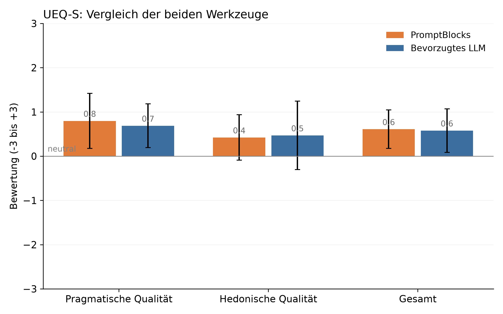
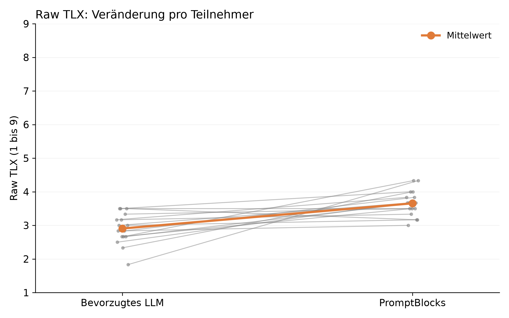

# PromptBlocks – Thesis Analysis

Statistics script for the user study of my bachelor thesis
*"Strukturierte Visualisierung und Verwaltung von Prompts für Large Language Models"*
(TU Dortmund, 2026). It compares **PromptBlocks** – the LibreChat extension from [batuhanbaharr/LibreChat](https://github.com/batuhanbaharr/LibreChat/tree/promptblocks-reactivation) – with the chat
tool each participant normally uses.

The script is the one printed in Appendix C of the thesis. All tables and most figures in Chapter 5 come from it
(see [what the script does not cover](#what-the-script-does-not-cover)).

## The study in short

| | |
|---|---|
| **Design** | Within-subject, 16 participants, each used PromptBlocks and their preferred LLM once |
| **Counterbalancing** | 4 combinations (Latin square) of tool order × task assignment, 4 participants each |
| **Tasks** | Task A: four independent programming/design sub-tasks. Task B: four independent creative communication tasks. Both end with steps that return to earlier topics and a final summary |
| **Instruments** | UEQ-S (8 items, user experience) and NASA-TLX (6 dimensions, workload), plus five open questions |
| **Primary measures** | UEQ-S overall (H1: PromptBlocks is rated better) and Raw TLX (H2: workload is lower with PromptBlocks) |
| **Exploratory measures** | UEQ-S pragmatic and hedonic scales, the six TLX dimensions (not corrected for multiple comparisons) |

### Main results (as reported in the thesis, Chapter 5)

| Measure | PromptBlocks | Preferred LLM | Test | p | Effect size |
|---|---|---|---|---|---|
| UEQ-S overall (−3 … +3) | 0.84 (SD 1.11) | 0.59 (SD 1.03) | paired t-test | 0.460 | d = 0.19 |
| Raw TLX (1 … 9, higher = more load) | 3.49 (SD 1.35) | 2.56 (SD 0.96) | paired t-test | 0.003 | d = 0.90 |
| UEQ-S hedonic | 1.28 | −0.03 | paired t-test | 0.001 | d = 1.00 |
| UEQ-S pragmatic | 0.41 | 1.22 | paired t-test | 0.070 | d = −0.49 |

Neither hypothesis is confirmed: user experience overall is similar, and workload is *higher* with PromptBlocks,
mostly time pressure and mental demand, while frustration stays equally low. The thesis reads this as the cost of
getting to know a new concept rather than the cost of using it. Please see the thesis for the full discussion.

## What the script does

1. **Data checks** – drops incomplete rows, counts participants, finds participants with exactly one
   PromptBlocks row and one LLM row, and checks that the four combinations are balanced.
2. **Scale conversion** – UEQ-S items from the paper form (1–7) are shifted to the official −3 … +3 scale
   (`value − 4`). Pragmatic quality is the mean of items 1–4, hedonic quality the mean of items 5–8, overall the
   mean of all eight. Raw TLX is the unweighted mean of the six dimensions (performance already runs from
   *perfect* to *failed*, so a high value is unfavourable on every dimension).
3. **Descriptive table** – mean and SD per tool.
4. **Hypothesis tests** – per measure, on the per-person differences (PromptBlocks − LLM): Shapiro-Wilk decides
   between a **paired t-test** (Cohen's d) and a **Wilcoxon signed-rank test** (effect size r = z/√N).
5. **Control checks** – mean Raw TLX and UEQ overall by session and by task, to see whether order or task
   drove the results.
6. **Output** – `results.txt` and five charts (`ueq_comparison.png`, `tlx_dimensions.png`, `raw_tlx.png`,
   `raw_tlx_per_person.png`, `ueq_per_person.png`). Chart labels are in German, as in the thesis.

## Run it

```bash
git clone https://github.com/batuhanbaharr/promptblocks-thesis-analysis.git
cd promptblocks-thesis-analysis
pip install -r requirements.txt
```

The real study data is **not** part of this repository (participant privacy), so `study_data.csv` is git-ignored.
To try the script, run it on the synthetic example data:

```bash
cp example_data/study_data_synthetic.csv study_data.csv
python analyze.py
```

The script reads `study_data.csv` and writes its results into the **current working directory**, so run it from
inside this folder.

### Input format

One row per participant and tool, so two rows per participant:

| Column | Meaning |
|---|---|
| `participant` | participant id (any string) |
| `combination` | 1–4, the counterbalancing group |
| `session` | 1 or 2 |
| `task` | `A` or `B` |
| `tool` | `promptblocks` or `llm` |
| `ueq1` … `ueq8` | UEQ-S items, 1–7 as on the paper form |
| `tlx_mental`, `tlx_physical`, `tlx_temporal`, `tlx_performance`, `tlx_effort`, `tlx_frustration` | NASA-TLX, 1–9 |

Keep the CSV to exactly these columns: the script drops every row that has an empty value in *any* column.

### Example output

[`example_output/`](example_output) contains the results of running the script on the **synthetic** data
(random numbers, 16 fake participants, seed 42). It only shows what the output looks like. It says nothing about the
study.





`make_synthetic_data.py` regenerates the example file.

## Notes on the script

The script is kept exactly as printed in the thesis appendix so that the reported numbers stay reproducible.
Things worth knowing when reading or reusing it:

- **Two-sided tests.** `ttest_rel` and `wilcoxon` run with SciPy's default two-sided alternative, while H1 and H2
  are directional. The reported p-values (for example 0.460 for UEQ overall) are two-sided.
- **Paths.** The docstring says the data is read "from the same folder"; in fact `study_data.csv` and all outputs
  are relative to the working directory.
- **Chart count.** The docstring says five charts, which is what the script produces. The thesis text mentions six.
- **Wilcoxon effect size.** r is computed from a normal approximation of the rank sum without tie correction, with
  N = number of non-zero differences, so it can differ slightly from r computed with N = number of pairs.
- **Chart cosmetics.** Bar labels show one decimal while the text output shows two; the TLX axes start at 1, so bars
  are cut at the axis.

### What the script does not cover

Section 5.3.3 of the thesis reports follow-up checks that were run *after* the main analysis and are labelled as
unplanned hints: correlations between difference scores (pragmatic quality vs. Raw TLX, physical vs. temporal
demand), counts of participants showing a given pattern, and subgroup comparisons by task and by tool order.
Those are **not** produced by `analyze.py`.

## Related

- [PromptBlocks source code and setup](https://github.com/batuhanbaharr/LibreChat/blob/promptblocks-reactivation/PROMPTBLOCKS.md) (LibreChat fork, branch `promptblocks-reactivation`)
